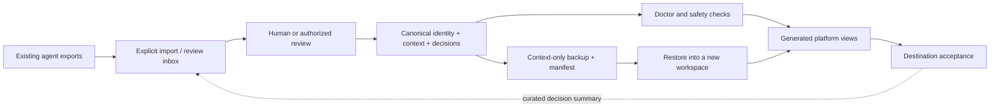

<div align="center">

# Agent@Manef

### One source of truth. Many agent platforms. Recoverable context.

Define agents once. Audit existing setups. Reconcile drift. Back up curated knowledge. Move to another platform without rebuilding your operating context.

[](https://github.com/rahmanef63/agent-at-manef/actions/workflows/ci.yml)
[](pyproject.toml)
[](LICENSE)
[](docs/architecture.md)

[Start here](docs/getting-started.md) · [Migrate existing agents](docs/migration.md) · [Backup & restore](docs/backup-restore.md) · [Platform support](docs/platforms.md) · [Bahasa Indonesia](README.id.md)

</div>

---


## Agent@Manef, formerly Agent SSOT

A Manef product created by Rahman: portable agent identity and curated context, independent
of the model, harness and hosting vendor. Repository slug: `agent-at-manef`. The existing
`agent_ssot` module, `agent-ssot` CLI and version-1 workspace/backup formats remain compatible.
The new namespace is `agent_at_manef`; source installation also provides `agent-at-manef`.
No PyPI/npm release or hosted agent library is implied by this rename.

[Library API](docs/library.md) · [Ecosystem review](docs/research.md) ·
[Instruction files](docs/instruction-files.md) · [Product roadmap](docs/product.md)

The designated upstream is `rahmanef63/agent-at-manef`. Repository ID `1414110928` was renamed
in place; at the last verified ownership read it still belongs to `official-manef` while the
transfer awaits acceptance. This review branch prepares the canonical links; do not mark the
ownership migration complete or create a conflicting replacement repository. See
[the transfer runbook](docs/governance.md).

## The problem

An agent's identity lives in one app, its project decisions in another, and its useful working context somewhere in a chat history. Over time, copies disagree. A fresh machine starts with the wrong instructions. Cleaning up an old profile risks deleting the only useful copy.

**Agent@Manef separates the durable agent definition from the software that runs it.** Canonical Markdown and small JSON descriptors hold the context you own. Generated platform views adapt that context. Private credentials and live session databases remain outside both.

This is a **local-first context lifecycle toolkit**, not a hosted service, universal agent runtime, or a promise of identical model behavior.

## Choose your starting point

| Your situation | Recommended path | Outcome |
|---|---|---|
| Building an agent for the first time | [Create a workspace](docs/getting-started.md) | A canonical charter, accountable owner and contextual knowledge |
| Agents already exist in several apps | [Inventory → import → review → reconcile](docs/migration.md) | Existing knowledge preserved; ownership and conflicts resolved deliberately |
| Moving to another machine or platform | [Backup → restore → render → accept](docs/backup-restore.md) | Verified context recovery, followed by explicit account/runtime setup |
| Existing generated files are outdated | [Drift and cleanup](docs/maintenance.md) | Managed updates with history; obsolete files quarantined, not blindly deleted |

## What it does

**Create and organize.** Define an agent's stable ID, owner, mission, charter, context and credential *names*. Keep decisions and reusable procedures in one canonical workspace.

**Adopt existing agents.** Inventory known instruction files without opening credential/config/session stores. Stage explicitly selected text in an untrusted review inbox. Identify byte-identical candidates without pretending that matching files mean matching identities.

**Reconcile safely.** Preview every create/update/conflict/stale action. Preserve local edits and unrelated files. Archive previous managed versions; optionally quarantine unchanged obsolete output. Never silently choose a winner in a conflict.

**Move and recover.** Export a bounded, context-only ZIP with SHA-256 manifests. Validate the archive before restoring into a new directory. Render the restored context for another supported platform.

**Keep claims honest.** Files prepared, native definitions discovered, accounts authorized, model understanding demonstrated, and tasks completed are separate states. See [acceptance](docs/acceptance.md).

## Quick start

Requirements: **Python 3.10+**. Git is needed only to clone this toolkit. Core commands have no third-party runtime dependencies, make no network requests and never launch an AI runtime.

```sh
git clone https://github.com/rahmanef63/agent-at-manef.git
cd agent-at-manef

# Preview first. No destination workspace is created.
python -m agent_at_manef init --target ../my-agent-context

# Create your own canonical context outside this public toolkit.
python -m agent_at_manef init --target ../my-agent-context --apply
python -m agent_at_manef doctor --workspace ../my-agent-context

# Prepare a platform view; review it before opening it in the destination app.
python -m agent_at_manef render --workspace ../my-agent-context \
  --platform codex --target ../my-codex-agents
python -m agent_at_manef render --workspace ../my-agent-context \
  --platform codex --target ../my-codex-agents --apply
python -m agent_at_manef verify --target ../my-codex-agents
```

On Windows, use `py -3` instead of `python` when appropriate; enter wrapped commands on one line in PowerShell. On Linux/macOS, `python3` may be the interpreter name. [Detailed setup](docs/getting-started.md) explains both paths.

The starter creates a fictional `researcher`. Open `../my-codex-agents/agents/researcher/` in the destination runtime and read its generated `AGENTS.md`. Configure tools/accounts through that platform's private setup. **Rendering does not start or authenticate an agent.**

> **Keep your context private.** This repository is public reusable tooling. Put personal/client context in a separate private workspace/repository. Do not add your agent files, credentials or backups to a public fork.

## Model, harness and host independence

The canonical format belongs to you, not to a model vendor, agent harness or VM provider.
Core commands need Python 3.10+ and a writable local filesystem; they do not require a model,
MCP server, cloud account, MSO installation, hosted service or active agent session.
The adapters generate **different views of the same source**, not six different agent identities.

```sh
# Machine-readable declaration for MSO and other host integrations; no workspace required.
python -m agent_at_manef capabilities
```

Host independence is not a promise that every device, serverless platform or browser can run
Python or a chosen agent harness. File portability, native registration, account access and
model-task acceptance are tested separately. See [portability contract](docs/portability.md)
and the [MSO consumer contract](docs/integrations/mso.md).

## Architecture



The return path is a **reviewed summary**, not automatic bidirectional synchronization. This keeps a runtime's temporary assumptions from silently overwriting durable knowledge.

```text
my-agent-context/                 # Your private source of truth
├── workspace.json
├── agents/
│   └── researcher/
│       ├── agent.json            # ID, owner, mission, credential names
│       ├── AGENT.md              # Canonical charter
│       └── context.md            # Curated project knowledge
├── policies/                     # Shared operating boundaries
├── decisions/                    # Dated decisions and supersession
├── skills/                       # Reviewed Markdown procedures
└── inbox/                        # Imported candidates; never active by default

my-codex-agents/                  # Generated, replaceable platform view
└── agents/researcher/            # No actual .env, cookies or session database
```

## Already have agents? Start with adoption, not deletion

```sh
# Read-only candidate inventory. Redirect reports only to a private location.
python -m agent_at_manef inventory --source /path/to/existing-agent

# Select a file deliberately; review the resulting inbox candidate.
python -m agent_at_manef import --workspace ../my-agent-context \
  --source /path/to/existing-agent --file SOUL.md \
  --agent researcher --platform hermes --apply
```

The original stays unchanged. The candidate is not automatically promoted, rendered or backed up. Review identity, account ownership, scope, stale claims, private identifiers and conflicts; then edit the existing canonical charter/context under version control. Never ask an importer to reconstruct missing history or retrieve provider-hidden prompts.

After review, reconcile the generated view:

```sh
python -m agent_at_manef reconcile --workspace ../my-agent-context \
  --platform codex --target ../my-codex-agents

# Optional: move ONLY unchanged, obsolete managed files into .ssot-history/.
python -m agent_at_manef reconcile --workspace ../my-agent-context \
  --platform codex --target ../my-codex-agents --quarantine-stale --apply
```

An unmanaged file or locally edited generated file becomes a **conflict**, not an overwrite. New platforms are best tested in a fresh output directory. [Full migration workflow](docs/migration.md).

## Backup once, render elsewhere

```sh
python -m agent_at_manef backup --workspace ../my-agent-context \
  --output ../context-backup.zip --apply
python -m agent_at_manef restore --archive ../context-backup.zip \
  --target ../restored-context --apply
python -m agent_at_manef render --workspace ../restored-context \
  --platform gemini --target ../my-gemini-agents --apply
```

Backups include canonical descriptors, charters, curated context, policies, decisions and Markdown skills. They exclude unreviewed inbox material, generated outputs, credentials and live runtime databases. They are **not encrypted or signed**. SHA-256 checks detect manifest/data mismatches, not a maliciously replaced archive. Store privately; use an approved encryption tool for transport. [Backup contract and recovery drills](docs/backup-restore.md).

## Platform support: output is not runtime parity

| Adapter | Output | What you must verify on the destination |
|---|---|---|
| Generic | `AGENTS.md`, scoped context, empty `env.example` | Explicit loading and source-cited readback |
| Codex | Per-agent `AGENTS.md` | Workspace instructions, tool access and task acceptance |
| Claude Code | `CLAUDE.md` and read-only `.claude/agents/*.md` | Native discovery and permissions in the installed version |
| Gemini CLI | Per-agent `GEMINI.md` | Loaded context and required account/tool access |
| Hermes | `SOUL.md`, `profile.yaml`, context and setup recipe | A fresh native profile, private configuration and native session acceptance |
| Grok Bot | Name/title/description fields, persona and setup recipe | Actual app creation/import, account isolation and task acceptance |

No adapter automatically installs a CLI, creates a hosted bot, activates hooks, deploys services or copies accounts. Hermes/Grokbot support here is a **portable setup bundle**, not a universal live-profile importer. See [platform-specific guides and primary sources](docs/platforms.md).

## Commands

| Command | Purpose | Default |
|---|---|---|
| `init` / `new` | Create canonical workspace / agent | Preview |
| `capabilities` | Declare interface/schema/adapter capabilities, without inspecting accounts | Read-only |
| `doctor` | Validate canonical schema and detect selected unsafe content | Read-only |
| `inventory` | Find known instruction files and identical-content candidates | Read-only |
| `import` | Stage one selected text source for review | Preview |
| `render` / `reconcile` | Generate views, inspect drift, preserve conflicts | Preview |
| `verify` | Check managed output integrity | Read-only |
| `backup` / `restore` | Context-only archive and validated recovery | Preview |

Use `python -m agent_at_manef COMMAND --help` for exact options. [CLI reference](docs/cli.md).

## Safety model

The toolkit rejects path traversal, symlink/reparse targets, case-colliding backup entries, oversized files/archives, malformed schemas and selected credential patterns. Writes are explicit, existing local edits are preserved, and runtime secrets are not loaded.

These guards are **not** OS sandboxing, complete PII/secret detection, signed provenance, automatic policy enforcement or a backup of everything an app knows. Anyone with access to the same OS account may still read sibling directories. Runtime and server-side permissions remain essential. See [security](SECURITY.md) and [threat model](docs/security.md).

## Documentation

[Getting started](docs/getting-started.md) · [Architecture](docs/architecture.md) · [Agent specification](docs/agent-spec.md) · [Existing-agent migration](docs/migration.md) · [Reconciliation & cleanup](docs/maintenance.md) · [Backup & restore](docs/backup-restore.md) · [Platform matrix](docs/platforms.md) · [Credentials](docs/credentials.md) · [Acceptance checklist](docs/acceptance.md) · [CLI reference](docs/cli.md) · [Troubleshooting](docs/troubleshooting.md) · [Roadmap](docs/roadmap.md)

## Canonical upstream and contribution forks

The designated upstream is **[rahmanef63/agent-ssot](https://github.com/rahmanef63/agent-at-manef)**.
Issues, releases, documentation links and stars should refer to this one source. Manef is the
maintenance/contribution identity; a fork is a working copy, not another product authority.
Contributor branches return changes through upstream pull requests. Fork updates must preserve
unique work and never use force-reset as a synchronization policy.

Ownership changes must finish before a former upstream address is reused as a fork. See the
[ownership and fork runbook](docs/governance.md), including acceptance and redirect checks.
The project does not create an organization, synchronize account credentials or run an automatic
fork-sync schedule.

## Development and contribution

```sh
python -m unittest discover -s tests -v
python scripts/check_docs.py
python scripts/smoke.py
```

Tests use synthetic fixtures. Core checks do not require paid model calls or real credentials. CI covers Linux, macOS and Windows; the badge above reflects actual workflow status. See [CONTRIBUTING.md](CONTRIBUTING.md) for changes and [CHANGELOG.md](CHANGELOG.md) for versioned scope.

**Version 0.1.0:** an initial, explicitly bounded implementation. Not affiliated with OpenAI, Anthropic, Google, Nous Research or xAI. Platform names belong to their respective owners.

MIT licensed. Created by [Rahman](https://github.com/rahmanef63). Maintained with [Manef](https://github.com/official-manef).

## Audit compatibility before migration

A familiar endpoint name does not guarantee the same tool, approval, session or host behavior.
Use `python -m agent_at_manef assess --requirements examples/requirements.json --target-profile examples/target-profile.json`.
The synthetic example intentionally exits 2 because required capabilities remain unknown.
Supported declarations need evidence references and dates; even a compatible declaration does
not establish authorization or a successful live test. [Assessment contract](docs/library.md).

Read the [ecosystem review](docs/research.md) for patterns from personal agents, open harnesses,
SDKs and model providers. Researched products are not automatically supported adapters.

## Candidate 0.2.0rc1

[Release checks](docs/release.md) · [Adapter conformance](docs/adapters.md) · [Catalog metadata](docs/catalog.md)

This candidate adds a reviewed static adapter registry and read-only catalog validation.
CI builds wheel/sdist, checks offline installation, rebuilds the source archive and exercises
recovery. These are candidate artifacts, not a registry release, hosted catalog, native runtime
login or live MSO integration. Legacy schema and CLI aliases remain supported.

## Optional encrypted recovery

The default context ZIP is still unsigned and unencrypted. The opt-in
[age/minisign transport](docs/secure-transfer.md) encrypts a validated ZIP and verifies the
pinned sender signature before decryption and v1 restore. Signing stays in the sender's
private terminal; no keys enter this repo. External tools run only with explicit apply/execute.
Actual-tool recovery is tested separately from the model/harness-independent core.

---

## Catatan pemeliharaan (17 Oktober 2026)

This appendix records repository navigation and validation boundaries; the workflows above remain the starting point for using the toolkit.

### Repository map

- `agent_at_manef/` and `agent_ssot/` contain the two compatible Python namespaces and their command-line entry points.
- `docs/` contains workflow and contract details. See [getting started](docs/getting-started.md), [CLI reference](docs/cli.md), [architecture](docs/architecture.md), [security limits](docs/security.md), and [maintenance guidance](docs/maintenance.md).
- `examples/` contains sample catalog, requirements, and target-profile JSON files. `templates/` contains documentation and agent starter templates.
- `tests/` contains the test suite; `scripts/` contains documentation, release, recovery, and smoke-check utilities.

### Local validation

From the repository root, run the checks documented for contributors:

```sh
python -m unittest discover -s tests -v
python scripts/check_docs.py
python scripts/smoke.py
```

These commands are validation steps, not evidence that a particular checkout has passed them. A passing local check would not establish platform login, account authorization, model behavior, or destination-runtime acceptance; those require separate evidence as described in [acceptance](docs/acceptance.md).

### Scope and project status

The package metadata requires Python 3.10 or newer and declares no runtime dependencies. It defines the `agent-at-manef` and compatibility `agent-ssot` command-line entry points. The metadata version is `0.2.0rc2`; that does not imply a published package release.

The repository describes the designated upstream as `rahmanef63/agent-at-manef`, while the README’s governance note says the ownership transfer was awaiting acceptance at its last verified read. Do not represent that transfer as completed without new verification.
